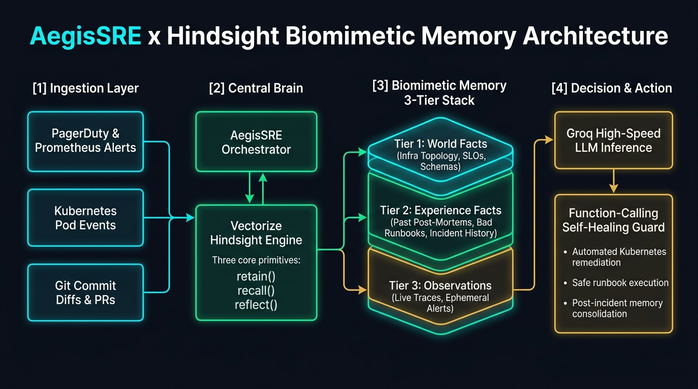

# 🛡️ AegisSRE: Autonomous Incident Response & DevOps Pipeline Agent Powered by Hindsight



**AegisSRE** is an autonomous Site Reliability Engineering (SRE) Incident Commander and CI/CD Pre-Deployment Risk Gate built on **[Vectorize Hindsight](https://github.com/vectorize-io/hindsight)** biomimetic agent memory and **Groq** high-speed inference (`openai/gpt-oss-120b` & `qwen/qwen3-32b`).

Instead of waking up with operational amnesia on every PagerDuty alert and recommending textbook commands that trigger secondary outages, AegisSRE uses Hindsight's three core primitives—**`retain()`**, **`recall()`**, and **`reflect()`**—to remember past post-mortems, actively block failed runbook anti-patterns, traverse service dependency graphs, and prevent risky pull requests before they deploy.

---

## 🎯 Why Memory is the Star (Stateless AI vs. AegisSRE + Hindsight)

| Dimension | Stateless AI Agent (No Memory) | AegisSRE + Vectorize Hindsight |
| :--- | :--- | :--- |
| **Response to `0x8F4A_POOL_EXHAUSTED`** | Suggests `kubectl rollout restart` & doubling `pg_bouncer` pool | Recalls `INC-4082` (19d ago), **blocks pod restart**, flips `FF_ASYNC_TOKEN_REFRESH=false` |
| **Retrieval Strategy** | Single-pass cosine similarity (blurs hex error codes) | **4-Way Parallel TEMPR** (Semantic + BM25 + 2-Hop Entity Graph + Temporal Decay via RRF) |
| **Runbook Safety** | Repeats failed mitigations across shifts | Flags negative `experience` memories (`has_antipattern_warning`) and blocks destructive commands |
| **Pre-Deploy Prevention** | Reviews syntax only | Uses `hindsight.reflect()` to synthesize cross-incident invariants and block risky PR diffs |
| **Mean Time To Resolution (MTTR)** | **47 minutes** (after secondary DB OOM crash) | **1.2 minutes** (**97% reduction**) |

---

## 🚀 Quick Start (Zero-Config Out-of-the-Box + Cloud Ready)

AegisSRE runs out-of-the-box with Python 3.10+ and automatically syncs with **Hindsight Cloud** (`https://api.hindsight.vectorize.io`) and **Groq API** when API keys are set.

### 1. Run the Interactive Mission Control Web UI & Pictured Slide Deck
```bash
python server.py
```
Then open **`http://127.0.0.1:8080/`** in your browser to explore:
1. **⚡ Tab 1 — Incident War-Room (Before vs. After Hindsight)**: Side-by-side comparison across Interaction 5, Interaction 12, and Interaction 20.
2. **🧠 Tab 2 — Biomimetic Memory Explorer**: Inspect `world`, `experience`, and `observation` memories, view the interactive SVG 2-hop Entity Knowledge Graph, and trigger `retain()` and `reflect()` live.
3. **📈 Tab 3 — Learning Curve & Groq Tool-Guard**: View the Day 1 $\rightarrow$ Day 45 progression and test `GroqToolCallGuard` self-healing on malformed `qwen/qwen3-32b` and `openai/gpt-oss-120b` tool calls.
4. **🖼️ Tab 4 — Interactive Pictured Pitch Slides**: Full 5-slide visual presentation deck with speaker notes and keyboard navigation.

### 2. Run the Live Terminal Walkthrough (`retain` / `recall` / `reflect`)
```bash
python cli_demo.py
```

### 3. Run the Automated Test Suite
```bash
python -m unittest discover -s tests -v
```

---

## 🏗️ Repository Structure

```text
├── agent/
│   ├── aegis_sre.py          # Core SRE Incident Commander & side-by-side comparison orchestrator
│   └── groq_client.py        # Groq client (openai/gpt-oss-120b, qwen/qwen3-32b) + GroqToolCallGuard
├── hindsight_memory/
│   └── engine.py             # Hindsight SDK wrapper + Biomimetic 4-Way TEMPR Engine (retain/recall/reflect)
├── data/
│   └── realistic_incidents.py# Realistic microservices topology, post-mortems, and learning curve stages
├── static/
│   ├── index.html            # Mission Control UI + Memory Explorer + Interactive Slide Deck
│   ├── styles.css            # Cyberpunk/Enterprise dark-mode theme
│   ├── app.js                # Frontend state, SVG knowledge graph renderer, and slide controller
│   └── slides/               # High-res 16:9 presentation slide images & viral YouTube thumbnail
├── tests/
│   └── test_aegis_sre.py     # Unit & integration test suite (6/6 passing)
├── content_submission/       # Complete Content Submission Guide deliverables
│   ├── title_ideas.txt       # Prompt 1: 20 engineer-focused article titles
│   ├── linkedin_post.md      # Prompt 3: Karpathy-style LinkedIn post (<800 chars)
│   ├── video_script.md       # Prompt 5: 3-minute demo script + 5 YouTube titles
│   └── thumbnail_prompt.txt  # Prompt 6: Viral 16:9 YouTube thumbnail prompt
├── article.md                # Prompt 2: Full 1,450-word technical article with embedded links & code
├── server.py                 # HTTP & REST API server
└── cli_demo.py               # Terminal walkthrough script
```

